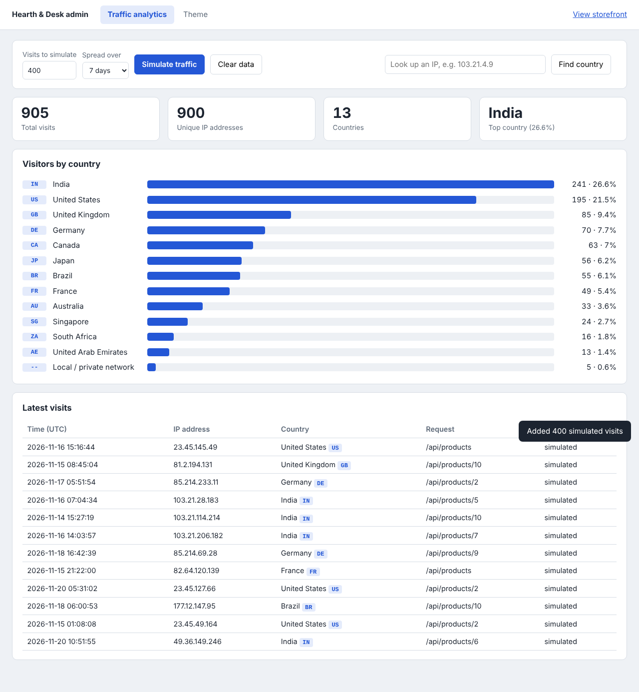
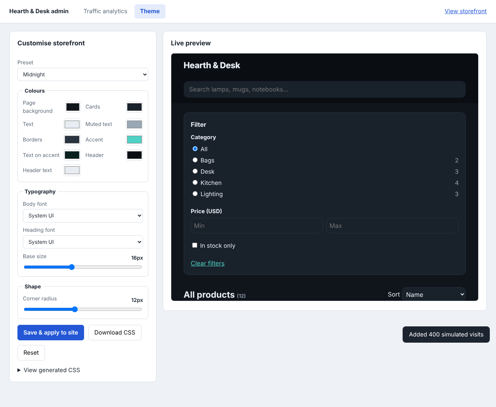

# Hearth & Desk — Storefront (Part 1) + Admin Dashboard (Part 2)

A small full-stack storefront: **vanilla JS frontend → FastAPI REST backend → SQLite relational database**.
The frontend never touches the database; every product it shows comes from `/api/*`.

| Listing | Details |
|---|---|
|  |  |

Search example: [docs/screenshots/search.png](docs/screenshots/search.png)

## Prerequisites
- Python 3.10+ (tested on 3.12) and `pip`
- A modern browser
- No separate database server needed (SQLite ships with Python)

## Run it (one computer, three commands)
```bash
python3 -m venv .venv && source .venv/bin/activate     # Windows: .venv\Scripts\activate
pip install -r requirements.txt
python db/init_db.py                                   # creates db/shop.sqlite3, loads products + IP ranges
                                                       # (safe to re-run on a Part 1 database: adds the new tables)
python -m uvicorn backend.main:app --port 8000         # start the app
```
Open **http://localhost:8000** (storefront) and **http://localhost:8000/admin/** (admin dashboard). Interactive API docs: **http://localhost:8000/docs**.

To wipe and re-seed the database: `python db/init_db.py --reset`.

### Configuration
There is none required. Defaults: port `8000` (change with `--port`), database file `db/shop.sqlite3`.

## Project layout
```
backend/main.py       FastAPI app: catalogue endpoints, visit-tracking middleware, serves the frontend
backend/analytics.py  Part 2: traffic simulation, IP→country lookup, distribution endpoints
backend/theme.py      Part 2: validated theme settings → generated CSS
backend/db.py         SQLite connection helper
db/schema.sql         Table definitions, constraints, indexes
db/seed.sql           Sample data (4 categories, 12 products)
db/geo_ranges.csv     Sample IP→country ranges (24 CIDR blocks, 12 countries)
db/init_db.py         Applies schema + seed to db/shop.sqlite3
frontend/             Storefront: index.html, styles.css, app.js, images/
frontend/admin/       Admin dashboard: index.html, admin.css, admin.js
scripts/              make_images.py (regenerates SVGs), screenshots.py (README images)
docs/screenshots/     Listing, search and details screenshots
```

## Architecture
```
Browser (HTML/CSS/JS, hash-routed SPA)
   │  fetch JSON
   ▼
FastAPI  /api/*  — validates query/path params, builds parameterised SQL, returns JSON + status codes
   │  sqlite3
   ▼
SQLite  categories 1───* products
```
- One process serves both the API (`/api/...`) and the static frontend (`/`), so the app runs as a single unit.
- **Schema:** `categories(id, name, slug)` and `products(id, name, description, price_cents, image_url, category_id → categories.id, stock, created_at)`. Prices are stored as integer cents to avoid floating-point errors; `CHECK` constraints reject negative price/stock; indexes cover category, name and price.
- **Security basics:** all SQL is parameterised; sort order is chosen from a fixed allow-list; the frontend escapes all API text before rendering.
- **Frontend routing:** `#/` (listing with filters in the URL, e.g. `#/?q=lamp&category=desk`) and `#/product/<id>` (details), so views are bookmarkable.

## API
Base path `/api`. Responses are JSON.

| Method & path | Description |
|---|---|
| `GET /api/health` | Liveness check → `{"status":"ok"}` |
| `GET /api/categories` | All categories with `product_count` |
| `GET /api/products` | Paginated, filterable list (below) |
| `GET /api/products/{id}` | One product |

`GET /api/products` query parameters (all optional):

| Param | Type / rule | Meaning |
|---|---|---|
| `q` | string, ≤100 chars | Case-insensitive match on name or description |
| `category` | category slug | e.g. `desk`, `kitchen`, `lighting`, `bags` |
| `min_price`, `max_price` | number ≥ 0 (dollars) | Price range |
| `in_stock` | boolean | Only items with stock > 0 |
| `sort` | `name` (default), `price_asc`, `price_desc`, `newest` | Ordering |
| `page`, `page_size` | int ≥1; page_size 1–50 (default 12) | Pagination |

Example:
```
GET /api/products?category=desk&sort=price_desc&page_size=2
{ "items":[{"id":3,"name":"Brass Pen Stand","price":26.0,"price_cents":2600,
            "image_url":"/images/brass-pen-stand.svg",
            "category":{"id":1,"name":"Desk","slug":"desk"},"stock":18,"in_stock":true, ...}],
  "total":3,"page":1,"page_size":2,"total_pages":2 }
```

Status codes: `200` success · `400` logically invalid input (`min_price > max_price`) · `404` unknown product id · `422` malformed input (non-integer id, bad `sort`, `page_size` > 50, negative price) · `503` database not initialised.

Try it:
```bash
curl "localhost:8000/api/products?q=lamp"
curl -i localhost:8000/api/products/999      # 404
```

## Regenerating screenshots (optional)
```bash
pip install playwright && playwright install chromium
python scripts/screenshots.py                # server must be running
```

---
# Part 2 — Admin dashboard (`/admin/`)

| Traffic analytics | Theme customiser |
|---|---|
|  |  |

## 1. User analytics
**How it works**
1. **Simulate traffic** (`POST /api/admin/simulate`) generates N visits from random IPv4 addresses, weighted by country (e.g. India 25%, US 22%), with timestamps spread over the last N days.
2. **Country identification:** each visit's IP is converted to an integer and matched against the `geo_ranges` table (`start_ip <= ip <= end_ip`, indexed). The country is stored on the `visits` row.
3. **Dashboard** shows total visits, unique IPs, a bar chart of the country distribution, and the latest visits. The "Find country" box looks up any IP.
4. **Real traffic** is also recorded: every `GET /api/products` and `/api/products/{id}` made by the storefront is logged by middleware with the caller's IP (`source = real`). On your own machine that is `127.0.0.1`, shown as "Local / private network".

**Limitations (be upfront about these):** the IP ranges in `db/geo_ranges.csv` are a small *sample dataset* for the simulation, not authoritative allocations. A production system would load a real database such as MaxMind GeoLite2 into the same table. IPv6 is not covered.

## 2. Dynamic CSS generation
The storefront's `styles.css` is written with CSS variables. The admin page lets you change them and generates a stylesheet that overrides them.
- **Options:** preset (Default, Midnight, Forest, Plum, Mono), 9 colours, body and heading font, base font size, corner radius. Fonts are system stacks so the site works offline.
- **Live preview:** the right-hand pane is the real storefront in an iframe; each change calls `POST /api/admin/theme/css` and injects the result.
- **Save & apply to site:** stores the theme in the `theme_settings` table. `index.html` links `/api/theme.css`, which is generated from the saved theme, so every visitor sees it immediately.
- **Download CSS:** saves `theme.css` to your computer. To use it as a static file, put it in `frontend/theme.css` and change the link in `frontend/index.html` from `/api/theme.css` to `/theme.css`.
- **Reset** returns to the default theme. All input is validated server-side (6-digit hex colours, allow-listed fonts, bounded sizes).

## Part 2 API (all under `/api`)
| Method & path | Description |
|---|---|
| `POST /admin/simulate` | Body `{count 1-5000, days 1-90}` → `201 {inserted}` |
| `GET /admin/lookup?ip=` | `{ip, country_code, country}`; `422` for an invalid IP |
| `GET /admin/analytics/countries?days=` | `{total_visits, unique_ips, countries:[{country_code, country_name, visits, unique_ips, percent}]}` |
| `GET /admin/analytics/recent?limit=` | Latest visits |
| `DELETE /admin/analytics` | Clear visits (`204`) |
| `GET /admin/theme` | Saved theme + font list + presets |
| `PUT /admin/theme` | Validate and save theme (`422` on bad values) |
| `POST /admin/theme/css` | Generate CSS from submitted settings (no save) |
| `DELETE /admin/theme` | Reset to default (`204`) |
| `GET /theme.css` → `GET /api/theme.css` | Live stylesheet for the storefront |

> The admin area is **not password-protected yet**; authentication and authorization are the Part 3 scope.
